# Guide utilisateur

Plateforme de digitalisation des **audiences et délibérés** - Direction Juridique, Afriland First
Bank Cameroun.

Ce guide s'adresse aux utilisateurs de l'application, pas aux développeurs. Il suit l'ordre dans
lequel on rencontre les écrans : se connecter, comprendre son accueil, puis chaque métier.

---

## 1. Se connecter

L'application s'ouvre sur un formulaire d'identification. Saisissez l'**identifiant** et le **mot de
passe** fournis par la DSI - ce sont ceux de votre compte Keycloak, non un compte propre à cette
application.

En cas de refus, le message ne précise jamais si le compte existe : c'est volontaire, et cela
protège vos comptes. Si vous avez oublié votre mot de passe, adressez-vous à la DSI ; cette
application ne le réinitialise pas.

**Votre première connexion vous rend visible des autres.** Un collègue n'apparaît dans les listes
d'affectation d'un dossier qu'**après avoir ouvert l'application au moins une fois**. C'est une
conséquence du fait que les comptes vivent dans Keycloak, administrés par la DSI : l'application ne
les connaît qu'à partir du moment où ils s'y présentent.

En pratique : si vous voulez confier un dossier à quelqu'un qui n'a encore jamais ouvert
l'application, affectez-le-vous d'abord, puis modifiez l'affectation dès sa première connexion - le
changement est tracé dans l'historique du dossier. Les **avocats** ne sont pas concernés : ils sont
affectables dès leur inscription au répertoire, sans attendre qu'ils se connectent.

**Changer de langue.** Les deux boutons `FR` / `EN` en haut à droite basculent toute l'interface. Le
choix est propre au navigateur, pas au compte : sur un autre poste, il faudra le refaire.

**Se déconnecter.** Le bouton *Se déconnecter* ferme aussi votre session Keycloak, pas seulement
l'application. Sur un poste partagé, c'est le seul geste qui empêche la personne suivante de
reprendre votre session.

---

## 2. Votre accueil

L'accueil affiche **ce qui vous attend** : une carte par file dont vous avez la charge, avec le
nombre en attente et un lien direct. Un compteur qui passe à l'orange signale du travail à traiter.

Les cartes dépendent de votre profil - l'Assistante voit les frais à contrôler, le SH les
constitutions à signer, le DJ les suppressions à arbitrer. Tout le monde voit ses **notifications
non lues**.

Les rôles qui vous sont attribués figurent en bas de l'écran. Si une fonction vous semble manquante,
c'est là qu'il faut regarder avant d'appeler la DSI.

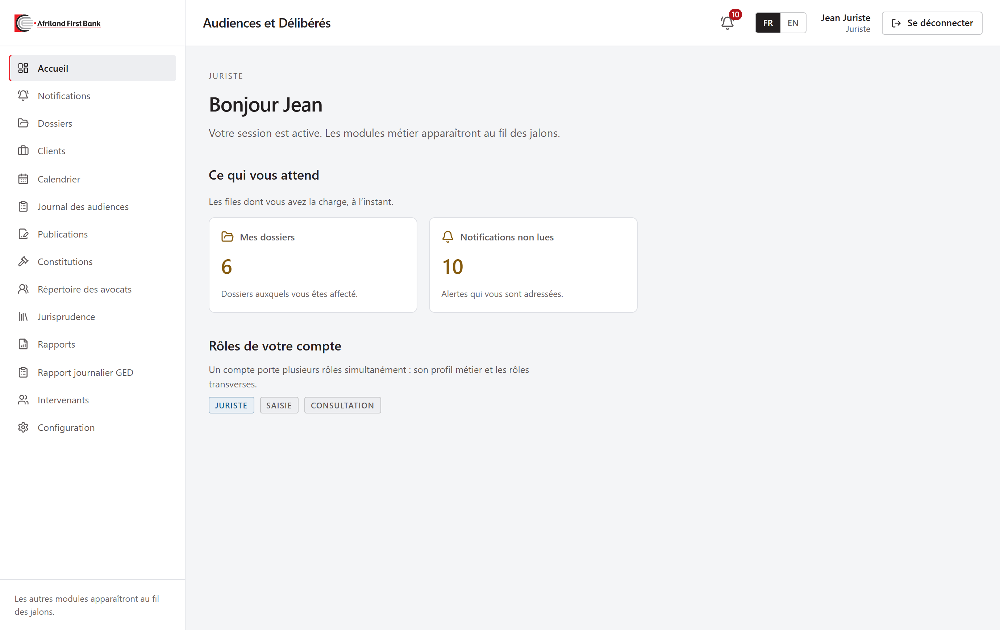

---

## 3. Notifications

La **cloche** en haut de l'écran porte le nombre de notifications non lues, quelle que soit la page
affichée. L'écran *Notifications* les liste, de la plus récente à la plus ancienne.

Un indicateur précise si le **temps réel** est actif. Actif, une alerte apparaît sans que vous ayez à
recharger. Interrompu - réseau coupé, poste en veille - la liste se met à jour toute seule au plus
tard dans la minute : **aucune notification n'est perdue**, seul l'affichage immédiat peut manquer.

*Marquer traitée* retire la notification des non lues. Vous ne pouvez traiter que les vôtres.

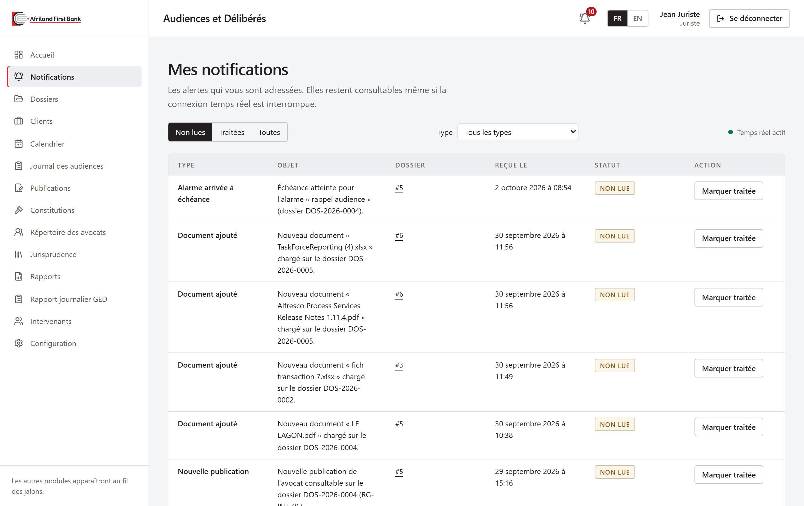

---

## 4. Dossiers

**Créer un dossier** (juriste) : *Dossiers* → *Nouveau dossier*. **La référence est attribuée par le
système** : vous ne la saisissez pas. À l'enregistrement, un message la nomme - « Dossier
DOS-2026-0001 créé. » - et la fiche s'ouvre sur ce dossier. Le numéro repart à 1 chaque 1er janvier.

**Les pièces se joignent à la création, et elles sont obligatoires** (depuis le 2026-09-29) : le
dossier de crédit d'origine et le PV de transfert pour un recouvrement, l'incident de compte et les
éléments justificatifs pour un litige d'exploitation. Tant qu'un fichier manque, l'enregistrement
est refusé et la pièce en cause est signalée. Les références qui les nomment, elles, sont
**facultatives** : c'est le document qui fait foi. Chaque fichier se relit d'un clic sur l'œil avant
l'envoi.

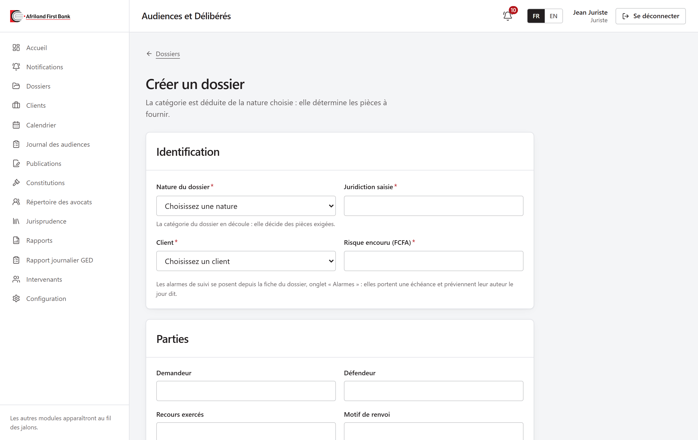

**Les parties au procès sont obligatoires** (depuis le 2026-10-05) : au moins un demandeur et un
défendeur. *Ajouter un demandeur* et *Ajouter un défendeur* en déclarent autant que l'affaire en
compte - une banque assigne souvent un débiteur **et** sa caution. La première ligne de chaque côté
ne se retire pas, puisqu'il en faut au moins une. Le client du dossier, lui, se choisit à part : il
est identifié au référentiel, pas ressaisi ici.

**L'agence d'origine est obligatoire, et elle se choisit** (depuis le 2026-10-05). Le champ
*Agence d'origine* n'est plus une zone de saisie : tapez les premières lettres du code ou du nom, et
la liste se réduite à mesure. Chaque ligne porte **le code, le mot « Agence », le nom et la
ville** - « 00002 · Agence BONANJO · Douala » - et, quand deux agences portent le même nom,
l'adresse apparaît en seconde ligne pour les séparer. *Agence du contentieux* reste facultative : renseignez-la quand le dossier est suivi
ailleurs qu'à l'agence où il est né. Seules les agences **ouvertes** sont proposées.

**Le référentiel des agences** se consulte depuis *Agences*, dans le menu. Tous les profils internes
le lisent ; **le DJ et la DJA seuls** y créent, corrigent et ferment une agence. Trois points à
connaître :

- **Le code ne se modifie pas** après création. Les dossiers le portent en clair : le changer les
  détacherait de leur agence sans que rien ne le signale. Une agence qui change de code est une
  autre agence - créez-la, puis désactivez l'ancienne.
- **On désactive, on ne supprime pas - et on peut rouvrir.** Une agence fermée quitte les listes de
  choix ; les dossiers ouverts sous elle restent intacts et lisibles. Sa ligne porte un bouton
  *Réactiver* : une fermeture faite par erreur se défait, et une agence qui réouvre reprend sa
  place avec **le même code**. Sans cela, il aurait fallu la recréer sous un code inventé.
- **La ville est obligatoire.** Deux agences peuvent porter le même nom, et c'est elle qui les
  distingue au moment de la saisie.

**Un dossier à diligence particulière** exige un seuil de montant et un type de client. Une dérogation au seuil
global se demande depuis la fiche et doit être validée par le DJ.

**La fiche** rassemble tout : identification, parties, pièces, affectations, diligence particulière, étapes,
audiences, délibérés, décisions et publications. Les onglets se partagent par lien : l'adresse porte
l'onglet ouvert, un collègue retrouvera exactement la même vue.

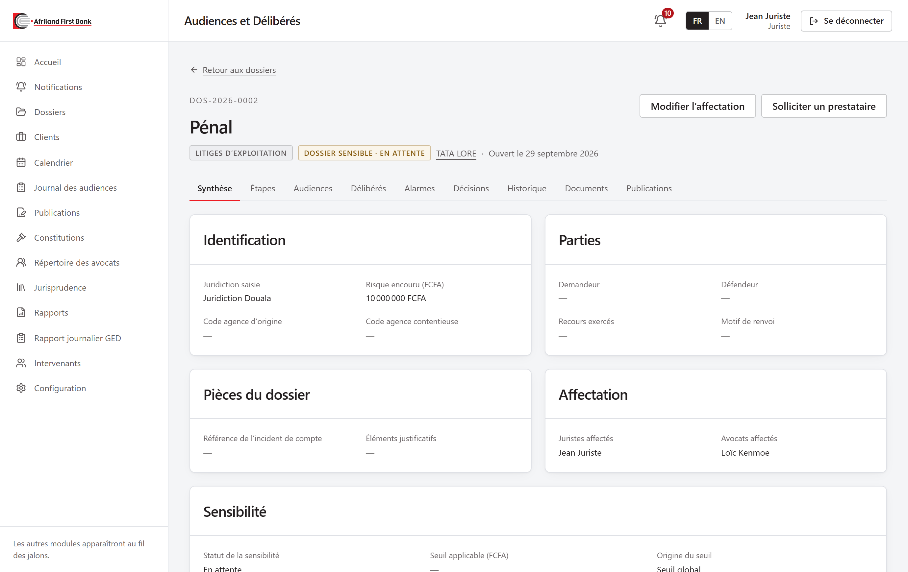

**Étapes.** Un dossier suit un cycle de degrés de juridiction - Instance, Appel, Pourvoi en cassation, Pourvoi CCJA. Les deux pourvois sont concurrents : un même dossier peut aller devant la Cour Suprême et devant la CCJA. Une audience ne se planifie que
sur une étape **en cours** : si le bouton n'apparaît pas, commencez par ouvrir l'étape.

**Chaque changement d'étape suppose que les faits aient eu lieu** (depuis le 2026-09-29). Si le
système refuse, il dit lequel manque :

- **En délibéré** : une audience au moins doit avoir été **tenue** - c'est-à-dire que son compte
  rendu est saisi - et aucune audience ne doit rester planifiée. Tenez-les ou annulez-les d'abord.
- **Exercer un recours** : le délibéré doit être **défavorable ou mixte**, et le délai de recours ne
  doit pas être expiré. On ne fait pas appel d'un procès gagné.
- **Clôturer** : l'issue du délibéré doit être enregistrée.
- **Archiver** : la décision définitive - adjudication ou condamnation - doit être saisie. Et si
  c'est la dernière étape du dossier, toutes les demandes de frais doivent être payées ou rejetées ;
  le message nomme alors les factures qui manquent.
- **Ouvrir les débats d'un appel ou d'un pourvoi** : le degré précédent ne doit pas être en délibéré.

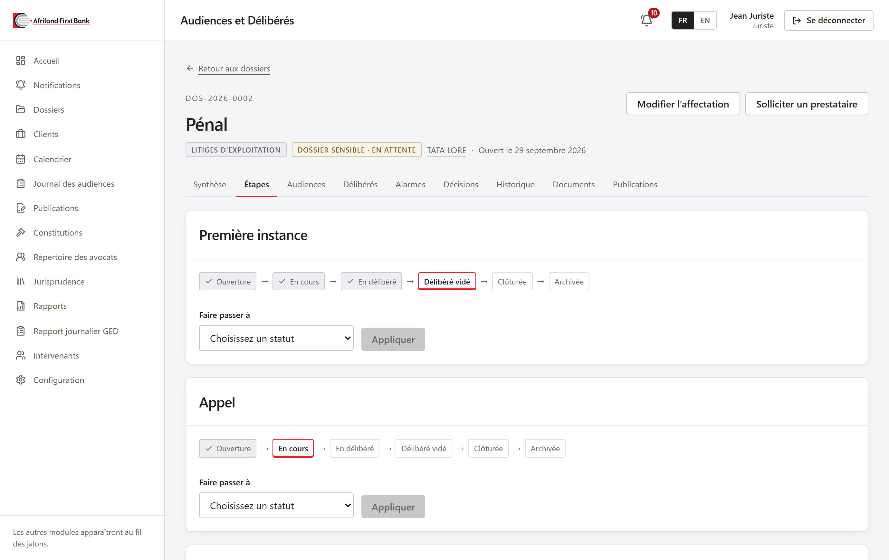

**Archiver à la jurisprudence** (onglet *Décisions*) est autre chose qu'archiver une étape : la
décision rejoint la base de précédents consultable par tous les juristes. Elle n'y entre que lorsque
le dossier n'a plus aucune étape en cours - une décision encore susceptible de recours ferait un
mauvais précédent.

**Retrouver des dossiers.** La barre de filtres croise la référence, le client, la juridiction, la
nature, la diligence particulière, l'**étape** et une **période d'audience**. *Étape* et *Statut de l'étape* se
lisent ensemble : « Appel » + « En cours » donne les appels en cours, et non les dossiers dont
l'appel est clôturé mais qui ont autre chose en cours. La période porte sur les **audiences** - les
dossiers passés devant un juge entre ces deux dates, les audiences annulées exclues - et non sur la
date d'ouverture. Un dossier porté à la fois devant la Cour Suprême et devant la CCJA remonte dans
les deux filtres : les deux procédures existent.

*Trier par* réordonne sans rien retirer : ouverture récente ou ancienne, référence, risque encouru.
Tous ces critères s'inscrivent dans l'adresse : une recherche se transmet par copier-coller, et
*Effacer* les remet à zéro d'un coup.

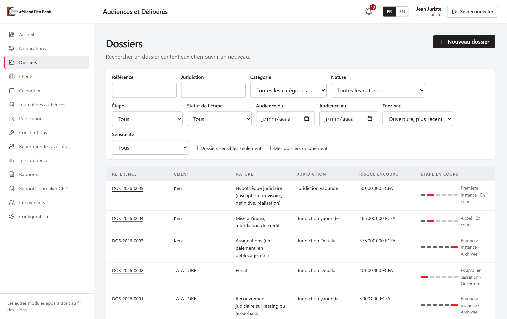

---

## 5. Audiences et délibérés

**Planifier une audience** depuis l'onglet *Audiences*. Le champ *Juridiction* propose celle du
dossier ; changez-la pour un appel ou un pourvoi, qui ne se tiennent pas devant le tribunal qui a
jugé. C'est ce lieu qu'annoncent ensuite le calendrier et le journal des audiences. Le système programme les rappels à J-7, J-3
et J-1.

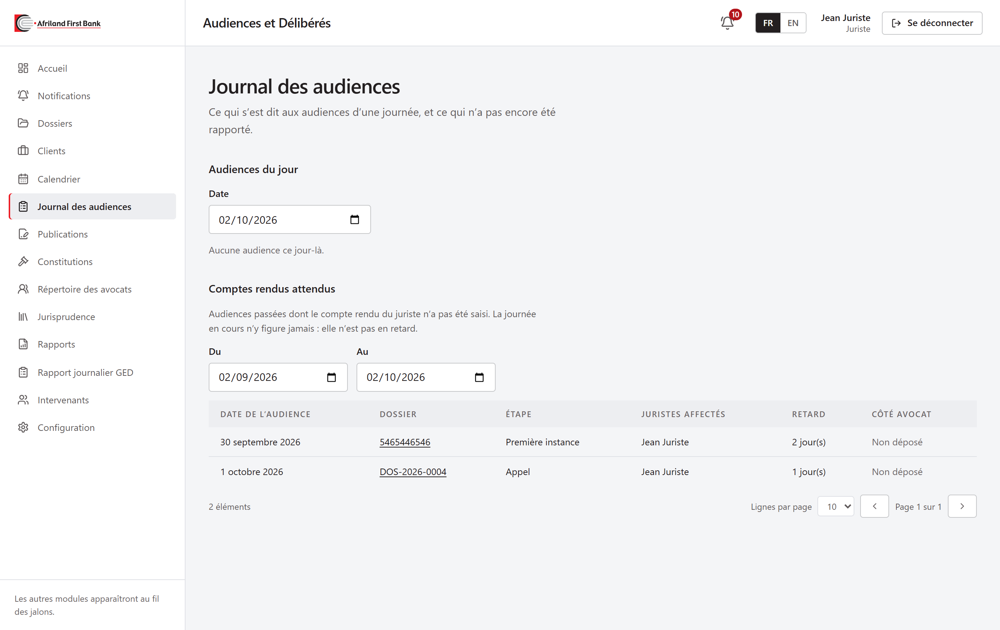

Une audience en double sur la même étape et la même date est signalée avant l'enregistrement - vous pouvez confirmer si le doublon est voulu.

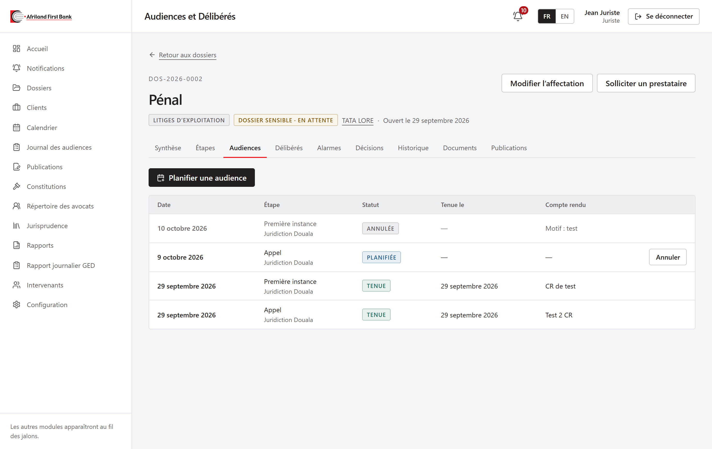

**Le calendrier** (*Calendrier*) présente les audiences par semaine, mois ou trimestre, et s'exporte
en PDF ou Excel.

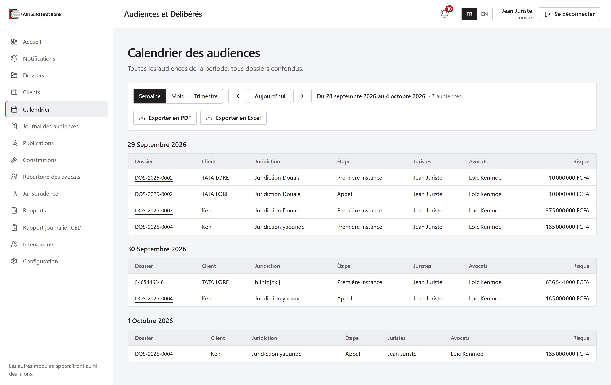

**Les alarmes** sont vos rappels de suivi : fiche du dossier, onglet *Alarmes*. Une alarme porte un
objet et une échéance, et prévient son auteur le jour dit ; la reprogrammer clôt l'ancienne et en
crée une nouvelle. C'est le seul mécanisme de rappel : aucun champ du formulaire de création n'en
produit.

**Un délibéré** s'enregistre à l'issue de l'audience. Il peut être **prorogé** - au-delà du seuil
configuré, une alerte part au DJ et à la DJA - ou **rabattu**, ce qui rouvre l'étape et permet de
planifier de nouvelles audiences. Le résultat rendu clôt le délibéré.

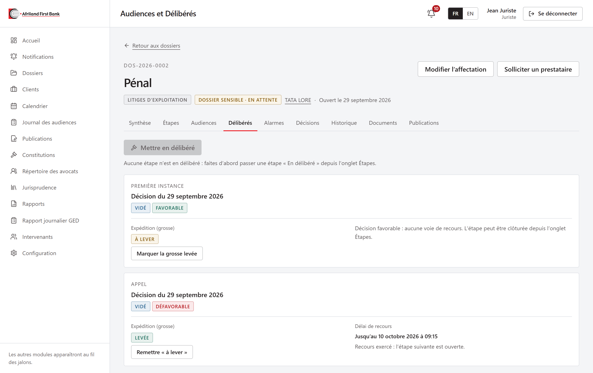

**Voie de recours.** Un délibéré défavorable ou mixte ouvre un délai de recours, suivi par une
alarme. Passé le délai sans recours, l'étape est close.

**Le compte rendu de l'avocat est réclamé tout seul.** Quand une audience est passée et qu'aucun
compte rendu d'avocat n'est arrivé, l'application relance l'avocat affecté par ses canaux
externes, puis le relance encore à la même cadence jusqu'au dépôt - cinq fois au plus. Le délai
se règle dans les paramètres système. Rien n'est envoyé si l'audience a été annulée, ni si
l'étape est close ou archivée.

---

## 6. Frais d'avocats

**Pour l'avocat.** *Déposer une demande* : choisissez le dossier, saisissez la référence de facture - elle doit être unique - le montant, puis **chargez vos pièces justificatives** (PDF ou images).
Chaque pièce part dès qu'elle est choisie ; son nom s'affiche, et vous pouvez la retirer avant
d'envoyer la demande.

**Le circuit**, dans l'ordre : dépôt par l'avocat → contrôle de **conformité** par l'Assistante →
contrôle d'**opportunité** par la DJA → **validation conjointe** DJ + DJA si le dossier est à diligence particulière
ou si le montant dépasse le seuil → enregistrement du **paiement** par l'Assistante.

Chaque profil ouvre l'application sur la file dont il a la charge. Un rejet exige toujours un motif,
et l'avocat en est notifié.

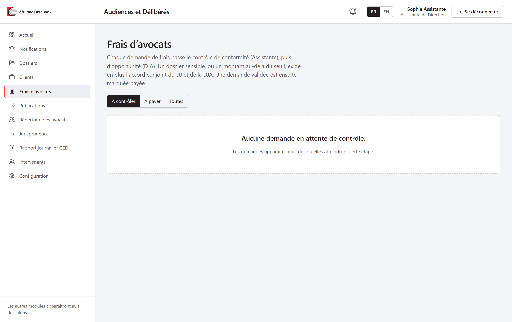

**Vérifiez vos pièces avant d'envoyer.** Chaque fichier chargé porte un œil : il s'ouvre sans
quitter le formulaire. Une fois la demande déposée, remplacer une pièce suppose une nouvelle
demande.

**Les pièces justificatives s'ouvrent** depuis le détail de la demande : le contrôle de conformité
porte sur les documents, pas sur leurs noms.

---

## 7. Publications et constitutions

**Pour l'avocat.** *Déposer une publication* pose une seule question : que déposez-vous ?

- un **compte rendu d'audience** - vous **relatez** une audience de votre dossier. Le récit est
  obligatoire, et vous pouvez y **joindre une pièce** (le plumitif, une note d'audience) : elle
  reste rattachée à la même audience, sans second dépôt ;
- un **document du dossier** - vous **transmettez** une pièce, une décision ou une conclusion. Le
  fichier est alors obligatoire, et vous en précisez la nature.

Les deux choix sont sur la même page, décrits l'un sous l'autre : le bouton d'envoi dit à chaque
fois ce qu'il fait. Les formats admis et le poids maximal sont les mêmes que pour la GED (§8).

**Le compte rendu d'audience n'attend pas.** Dès son dépôt, il est consultable par **toute la
Direction Juridique** : plus personne n'attend un contrôle pour savoir ce qui s'est dit à l'audience.
Les juristes affectés au dossier en sont alertés ; les autres le trouvent sur la fiche. L'Assistante
en **accuse réception** - elle ne l'autorise pas, et ne peut pas le rejeter : un récit d'audience se
conteste par une correspondance, pas en l'écartant. Un compte rendu ne se réserve pas non plus à un
destinataire : il appartient au dossier.

**Les documents du dossier, eux, attendent la validation.** Une pièce, une décision ou des conclusions
transmises par l'avocat ne sont visibles qu'une fois validées : leur conformité n'a pas encore été
contrôlée. En cas de rejet, le motif s'affiche dans *Mon espace* de l'avocat, avec le dépôt
concerné.

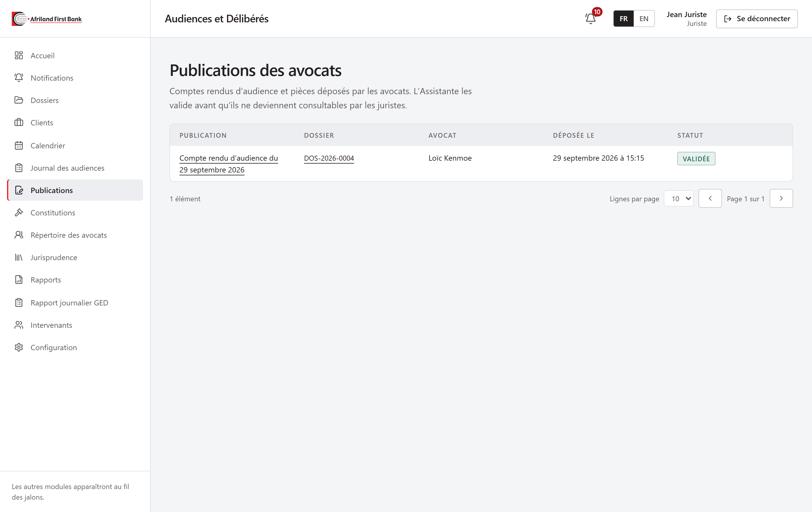

**Vérifiez votre fichier avant de déposer.** Un œil l'ouvre sans quitter le formulaire : une
publication déposée ne se corrige pas, elle se redépose.

**Pour l'Assistante et les juristes.** Une fois la publication validée, le compte rendu se retrouve
**depuis l'audience** : l'onglet *Audiences* du dossier porte un lien vers lui, à côté du compte
rendu du juriste.

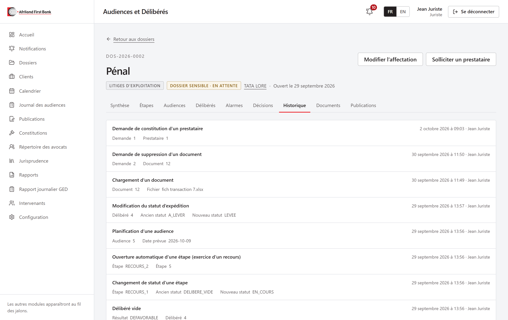

La fiche d'une publication montre le récit et, s'il y en a une, la **pièce
jointe** - consultable à l'écran ou téléchargeable, sans quitter la page. Un compte
rendu sans pièce n'affiche simplement pas ce bloc.

**Correspondance.** Un juriste commente une publication ; le DJ ou la DJA consolide ces commentaires
en une correspondance unique adressée à l'avocat. C'est la seule voie officielle d'échange.

**Constitutions.** Un juriste sollicite la constitution d'un prestataire ; le SH signe ; la lettre
est générée et rangée dans la GED du dossier. L'avocat constitué en est notifié.

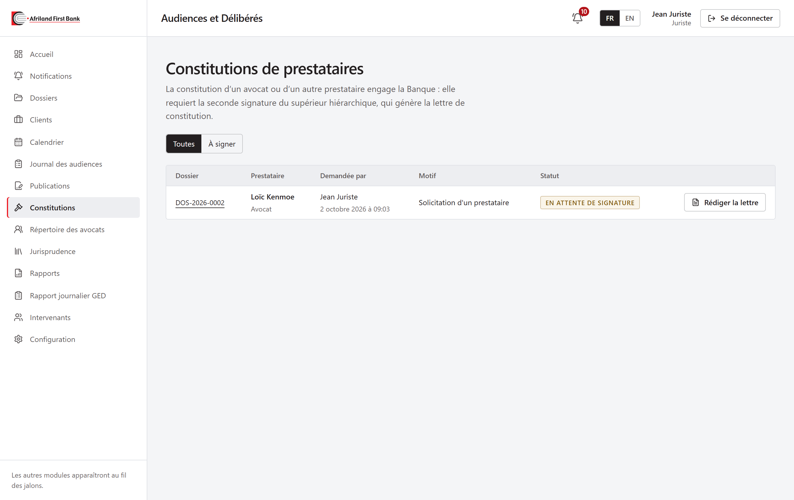

---

## 8. Documents (GED)

Les pièces se joignent à la création d'un dossier ou depuis l'onglet *Documents*. Les formats admis
et le poids maximal sont fixés par le DJ dans les paramètres système : PDF, images, texte, classeur
Excel et **documents Word** (depuis le 2026-10-02).

**Lire une pièce sans la télécharger.** L'œil ouvre le document dans l'application : PDF, images,
texte et `.docx` s'affichent tels quels - un Word montre sa mise en page, ses titres et ses
tableaux. Deux exceptions, annoncées à l'écran : un classeur Excel ne s'affiche pas, et un fichier
Word à l'**ancien format** `.doc` (Word 97-2003) non plus - aucun navigateur ne sait le lire. Dans
ces deux cas, téléchargez le fichier ; pour un `.doc`, le réenregistrer au format `.docx` depuis
Word le rend consultable dans l'application.

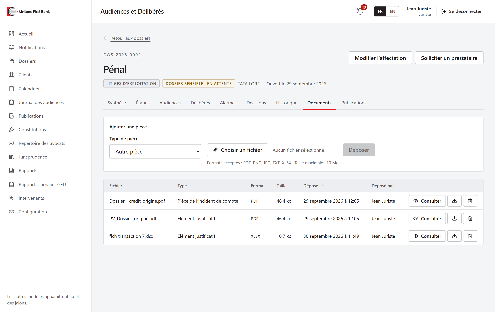

**Supprimer un document.** Un juriste en fait la demande, motivée ; le DJ ou la DJA arbitre. Le DJ et
la DJA peuvent supprimer directement. Une demande en attente est relancée au bout de 72 heures.

Le **rapport journalier** récapitule l'activité documentaire du jour : dossiers manipulés, pièces
ajoutées, affaires nouvelles.

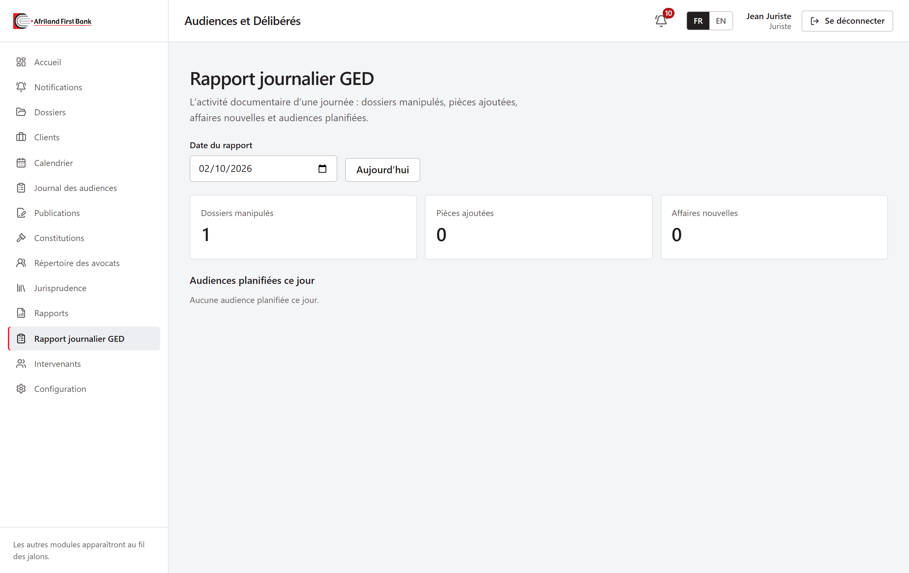

---

## 9. Décisions définitives et jurisprudence

Quand les recours sont épuisés, la décision devient définitive : enregistrez une **adjudication**
(bénéficiaire, provision reprise, soulte, reliquat) ou une **condamnation pécuniaire**, depuis
l'onglet *Décisions* de la fiche.

La décision peut ensuite être **archivée** dans la base jurisprudentielle, avec ses mots-clés, sa
nature, sa juridiction et sa date. La recherche (*Jurisprudence*) accepte des fragments de mots et
ignore la casse - « saisie » retrouve « Saisie immobilière ». Les accents, eux, comptent.

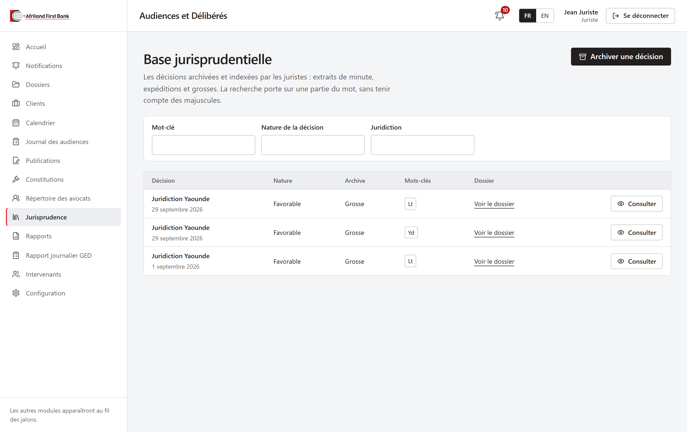

---

## 10. Pilotage (DJ et DJA)

**Tableau de bord** : six indicateurs en temps réel - dossiers actifs, audiences planifiées, frais en
attente, alertes de prorogation, taux de succès du recouvrement, provisions reprises. Chacun porte
une phrase disant ce qu'il compte.

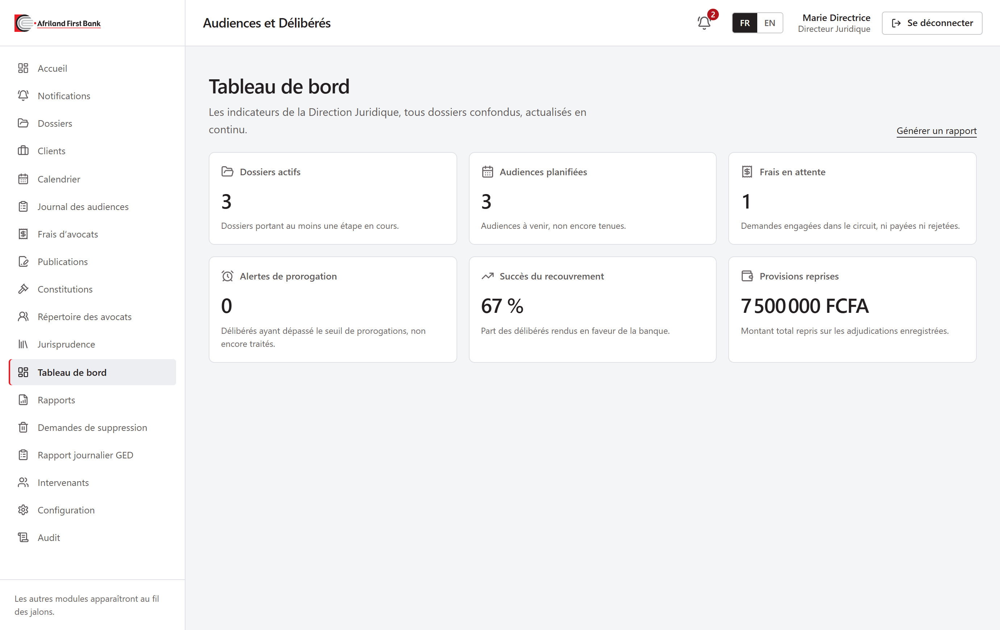

**Rapports** : choisissez une période, affichez, puis exportez en PDF, Excel ou CSV. Une période sans
activité affiche un état vide - ce n'est pas une erreur, il n'y a rien à rapporter.

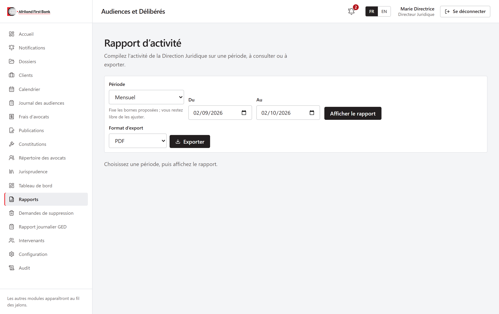

**Vue consolidée d'un client** : toutes ses procédures, groupées par catégorie, depuis la fiche du
client.

**Audit** (DJ et DJA) : qui a fait quoi, quand. Les filtres croisent la **portée** - tout
l'historique, les actions système hors dossier, ou un dossier précis -, l'**auteur**, la **nature
de l'action** et une **période**. Une période à l'envers est refusée par un message, jamais par une
erreur technique.

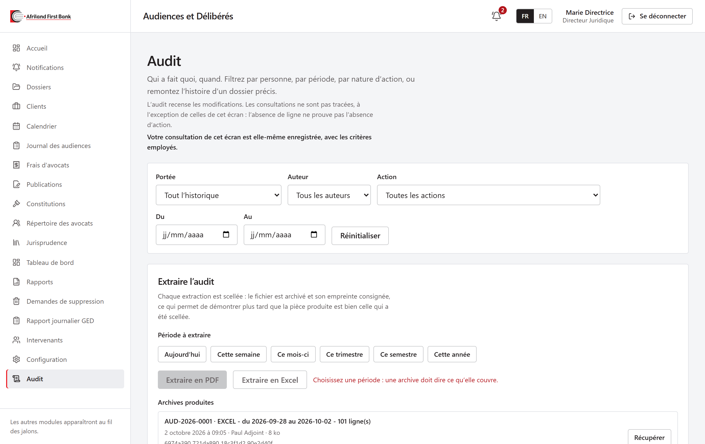

**Ce que l'audit couvre, et ce qu'il ne couvre pas.** Il recense les **modifications**. Les
consultations ne sont pas tracées, à une exception près : celles de cet écran. L'absence de ligne ne
prouve donc pas l'absence d'action - elle prouve qu'aucune modification n'a eu lieu. Et votre propre
consultation de l'audit est enregistrée, avec les critères que vous avez employés.

**Extraire.** Choisissez une période - aujourd'hui, la semaine, le mois, le trimestre, le semestre,
l'année - puis extrayez en PDF ou en Excel. Une extraction sans période est refusée : une archive
doit dire ce qu'elle couvre. Chaque extraction est **scellée** - le fichier est conservé et son
empreinte SHA-256 consignée. Les extractions déjà produites sont listées en dessous : *Récupérer*
retélécharge le fichier d'origine, *Copier* place son empreinte dans le presse-papiers.

**Vérifier un fichier reçu.** Déposez le document : son empreinte est calculée **sur votre poste**,
le fichier ne quitte pas votre machine, et elle est comparée aux archives produites ici. S'il est
reconnu, il n'a pas été modifié depuis son scellement, et l'application nomme l'archive, sa période
et son nombre de lignes. Sinon, c'est qu'il a été modifié ou qu'il ne provient pas de cette
application : transmettez l'empreinte affichée pour comprendre.

Deux limites à connaître. Le scellement **n'atteste pas l'antériorité face à un tiers** : l'application
détient à la fois le fichier et sa trace, elle est juge et partie. Et le calcul d'empreinte exige une
**connexion sécurisée** - il fonctionne en HTTPS et sur `localhost`, mais pas sur une page ouverte en
`http://` depuis l'adresse IP d'un autre poste. En recette depuis plusieurs machines, la vérification
est donc indisponible ; l'extraction et le scellement, eux, fonctionnent normalement.

**Paramètres système** (DJ) : neuf réglages pilotent les seuils, les délais, le poids et les formats
admis en GED, et les canaux de notification. Une valeur incohérente est refusée à la saisie, avec
la raison. Un changement prend effet immédiatement, pour tout le monde. La **grille des
notifications** - quel événement part sur quel canal - se règle à part, dans son propre tableau.

---

## 11. Portail avocat

L'avocat est un utilisateur **externe** : il ne voit que ce qui le concerne. Trois entrées :

- **Mon espace** - ses dépôts, avec leur statut et le motif d'un éventuel rejet, et les lettres de
  constitution qui le désignent ;
- **Déposer une demande** - une demande de frais ;
- **Déposer une publication** - un compte rendu d'audience (avec sa pièce, si besoin) ou un
  document du dossier.

**Vous serez relancé si un compte rendu manque.** Passé le délai fixé par la Direction Juridique,
une audience tenue dont vous n'avez pas déposé le compte rendu déclenche un rappel, répété
jusqu'à votre dépôt. Déposer le compte rendu suffit à arrêter les rappels - ils ne guettent que
le dépôt. Votre compte rendu suit ensuite son cours habituel : l'Assistante le valide, et c'est
cette validation qui le diffuse.

Il ne voit que les dossiers auxquels il est affecté, et seulement leur référence, leur nature et leur
juridiction. Ni client, ni montant en jeu, ni diligence particulière.

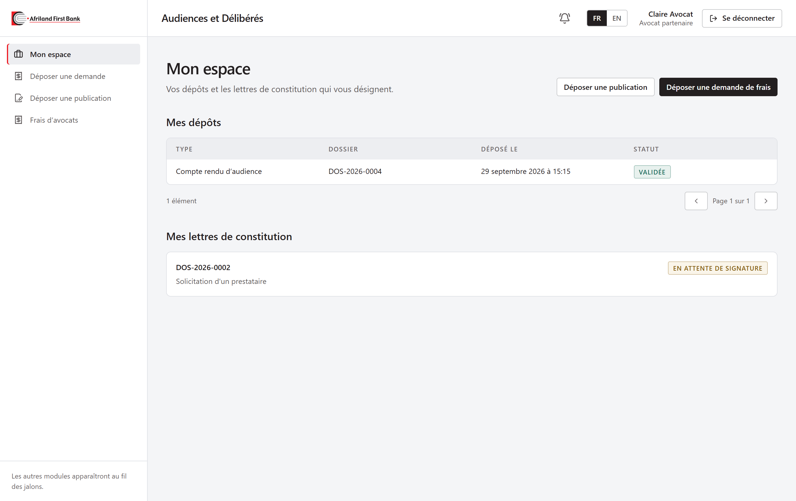

---

## 12. Questions fréquentes

**Une fonction a disparu de mon menu.** Le menu n'affiche que ce à quoi vous avez droit. Vos rôles
sont listés sur l'accueil.

**« Vous n'avez pas les droits nécessaires ».** L'écran est réservé à d'autres profils. Si vous
pensez que c'est une erreur, contactez la Direction Juridique - vos droits viennent de Keycloak.

**Ma référence de facture est refusée en doublon.** Une référence de facture ne sert qu'une fois,
y compris si la demande précédente a été rejetée : saisissez celle de votre nouvelle facture.
Les références de dossier et de client, elles, ne peuvent jamais être en doublon - c'est le
système qui les attribue, vous ne les saisissez pas.

**L'application est lente.** Les vues courantes répondent en moins de deux secondes sur un jeu de
données de recette. Une lenteur durable se signale à la DSI avec l'écran concerné et l'heure.

**Sur téléphone.** L'interface s'adapte : la navigation devient une bande horizontale défilante en
haut de l'écran, et les tableaux larges défilent dans leur propre cadre.
